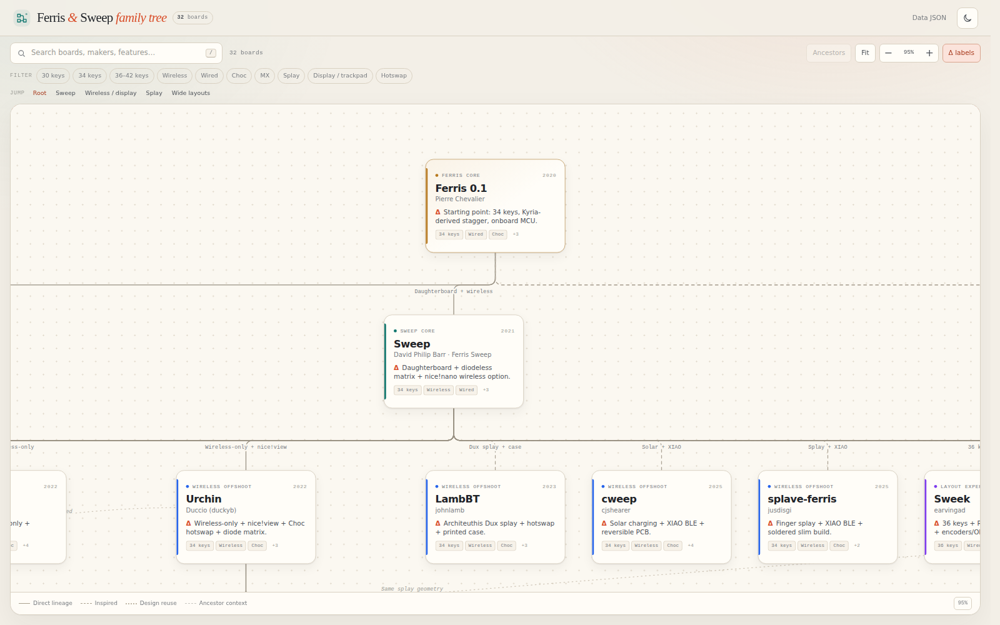

# The Ferris & Sweep Family Tree

An interactive, scrollable genealogy of split keyboards descended from Pierre Chevalier's **Ferris** and David Philip Barr's **Sweep**.

The tree maps **32 open-source boards** and records the design delta at every branch: daughterboards and wireless controllers, MX vs Choc, spacing, splay, extra thumb keys, reversible PCBs, displays, trackpads, solar charging, and more.

[](assets/preview.png)

## What's inside

- **A single-screen flow chart** rendered as SVG + HTML, with no framework and no build step. The map is the page.
- **31 primary branches** plus two cross-links, showing direct lineage, inspired designs, and narrower design reuse.
- **A change label on every edge**, plus a detail drawer with the full list of changes and a source link.
- **Evidence for every card** — each board quotes the README or product page that supports its placement.
- **Search and feature filters** for key count, wireless, switch type, splay, displays, and hotswap. Filtering hides non-matching boards, rebuilds the tree at a narrower width, and keeps only the path back to the root.
- **Ancestor context** is shown as dashed cards by default, with a one-click toggle to hide it and show only the matching boards.
- **Keyboard and pointer navigation** — drag to pan, scroll to move, `Ctrl`/`⌘` + wheel to zoom, `F` to fit. Filtering does not auto-zoom; matches are brought into view at the current scale.
- **Light and dark themes**, responsive layout, and deep links to individual boards (e.g. `#urchin`).
- **A machine-readable JSON graph** with a validator and a GitHub Pages workflow.

## Run locally

The page is a static site. The only requirement is something that serves files over HTTP:

```sh
python3 -m http.server 8000
# open http://localhost:8000
```

Opening `index.html` directly also works in most browsers because `data/family-tree.js` is a generated mirror of the JSON data. A local server is still the recommended path.

## Deploy to GitHub Pages

1. Push this directory to a GitHub repository.
2. Go to **Settings → Pages** and set **Source** to **GitHub Actions**.
3. The included workflow (`.github/workflows/pages.yml`) validates the data and deploys the static files on every push to `main`.

The site has no runtime dependencies, so it also works on any static host.

## Data model

The canonical graph lives in [`data/family-tree.json`](data/family-tree.json). There are three main sections:

- `nodes` — boards, with maker, year, summary, branch, tags, the changes introduced at that step, evidence, and a source URL.
- `links` — edges between boards. `primary: true` links form the tree; secondary links are rendered as dotted design-reuse connections.
- `branches`, `tags`, and `filters` — presentation metadata and filter definitions.

A minimal node looks like this:

```json
{
  "id": "urchin",
  "name": "Urchin",
  "maker": "Duccio (duckyb)",
  "year": "2022",
  "branch": "wireless",
  "order": 280,
  "summary": "A wireless-only Sweep redesign…",
  "delta": "Wireless-only + nice!view + Choc hotswap + diode matrix.",
  "changes": [
    "Strictly wireless-only design for nice!nano and ZMK.",
    "Native nice!view display support."
  ],
  "tags": ["34k", "wireless", "choc", "hotswap", "display"],
  "evidence": "Urchin README: …",
  "source": {
    "label": "GitHub · Urchin",
    "url": "https://github.com/duckyb/urchin"
  }
}
```

And a link:

```json
{
  "from": "sweep",
  "to": "urchin",
  "type": "fork",
  "label": "Wireless-only + nice!view",
  "primary": true
}
```

### Lineage types

| Type | Meaning | Rendering |
| --- | --- | --- |
| `fork` | The project says it is based on, or a fork/derivative of, the parent. | Solid |
| `variant` | An official variant in the parent project’s repository. | Solid |
| `inspired` | The README credits the parent as inspiration, but the design is a fresh build. | Dashed |
| `reuse` | A specific subsystem was borrowed; used only for secondary links. | Dotted |

## Editing the data

1. Edit `data/family-tree.json`.
2. Regenerate the offline mirror:
   ```sh
   node scripts/build-data.mjs
   ```
3. Validate IDs, parent links, cycles, tags, sources, and the mirror:
   ```sh
   node scripts/validate-data.mjs
   ```
4. Reload the page.

The validator runs in CI on every push and pull request.

### Adding a board

- Add a node with a unique kebab-case `id`, a numeric `order` for sibling sorting, and an `evidence` line that quotes or closely paraphrases the project.
- Add one `primary` link to its parent. The tree expects exactly one root and one primary parent per non-root node.
- Use `inspired` when the project only credits the layout or concept.
- Add a secondary `reuse` link only when a specific piece of design was borrowed.
- Keep the `changes` list focused on what is different from the parent, not a full spec sheet.

## Project structure

```text
.
├── index.html                  # static page shell
├── styles.css                  # layout, tree canvas, cards, drawer, themes
├── app.js                      # data load, layout, SVG edges, interactions
├── data/
│   ├── family-tree.json        # canonical graph (edit this)
│   └── family-tree.js          # generated file:// mirror
├── scripts/
│   ├── build-data.mjs          # JSON -> JS mirror
│   └── validate-data.mjs       # graph + generated-file checks
├── assets/preview.png          # README / social preview
├── favicon.svg
└── .github/workflows/          # Pages deploy + data validation
```

## Scope and corrections

This is a **curated map**, not an exhaustive fork list. It favours boards with public design files, a clear credit line, and a meaningful design change. Years are approximate for projects whose repositories predate their public release.

- “Wireless” means the board supports a BLE controller such as a nice!nano; it does not imply a pre-built wireless kit.
- Choc/MX tags describe the switch families the PCB supports, not necessarily every build option.
- The project is independent and unofficial. Keyboard names, designs, and trademarks belong to their makers.

Corrections are welcome: update the JSON, keep the evidence line accurate, and run the validator.

## Credits

The tree is built from the public documentation of projects including:

- [Ferris](https://github.com/pierrechevalier83/ferris) by Pierre Chevalier
- [Sweep](https://github.com/davidphilipbarr/Sweep) by David Philip Barr and contributors
- [Swoop](https://github.com/jimmerricks/swoop), [Urchin](https://github.com/duckyb/urchin), [swweeep](https://github.com/sadekbaroudi/sweep36), [Sweep Squared Rotated](https://github.com/ezxzeng/sweep_squared_rot), [RAII](https://github.com/unspecworks/raii), [RAII Wireless](https://github.com/unspecworks/raii-wireless), [Cantor](https://github.com/diepala/cantor), [Aurora Sweep](https://splitkb.com/products/aurora-sweep), and the other projects linked from the cards.

The site code and original data are released under the [MIT License](LICENSE). Project names and source material remain the property of their respective creators.
